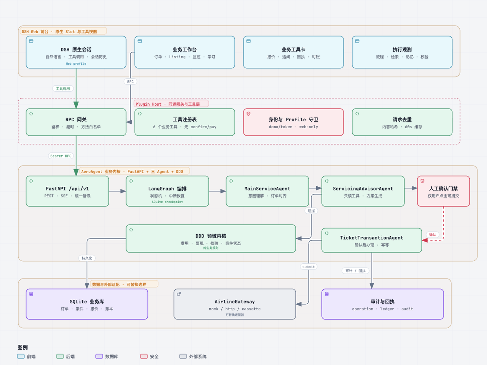
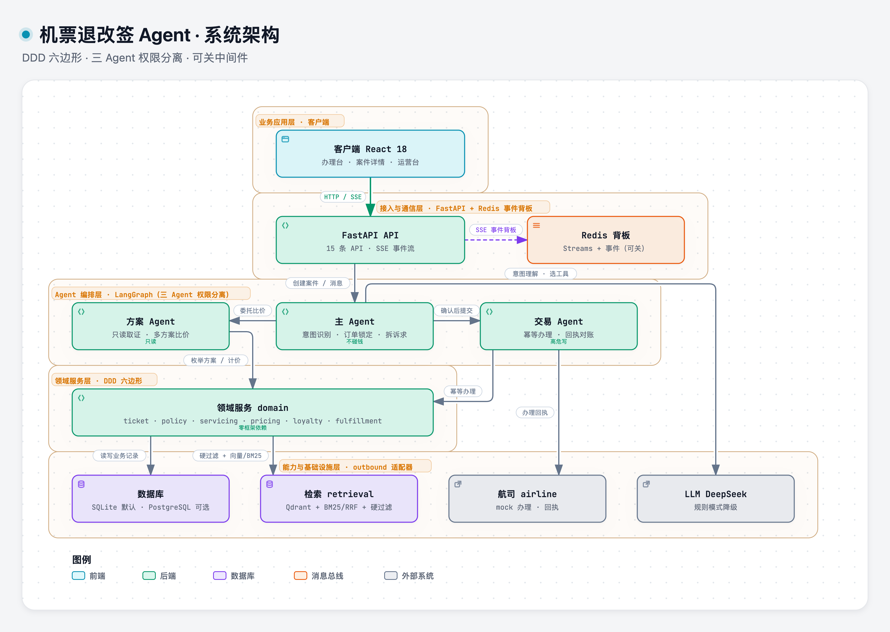

# AeroAgent

AeroAgent 是一个面向机票退改签场景的企业级垂直 Agent。它以 **DeepSeek Harness 为原生交互前台**，以 **FastAPI + LangGraph + DDD 分层为业务内核**，把“理解诉求 → 检索票规 → 计算费用 → 生成方案 → 人工确认 → 航司办理 → 结果对账”收束成一条可解释、可审计、可替换的业务闭环。
它不是一个套在订单系统外面的聊天机器人：三 Agent 在编排层各司其职，领域层只表达费用、票规、校验与状态规则，交易层只接受用户确认后的指令，航司接口以适配器隔离。前台可以换、宿主可以换，业务内核始终自主可控。

## 架构



- **三 Agent 分层**：理解、方案、交易三类 Agent 权限逐层收窄，模型能力被约束在业务边界内。
- **DDD 业务内核**：费用、票规、校验、案件状态与交易边界不依赖 Web 框架或 LLM，换前端、换模型不换业务。
- **DSH 原生体验**：工具卡、报价确认、执行观测都在 DSH 原生 Slot 内完成，不是 iframe 或第二个外壳。

> 所有航班、订单、票价与航司回执均为虚构数据；项目不连接真实航司、GDS 或支付渠道。

### 界面预览



## 为什么是 AeroAgent

| 亮点 | 为什么重要 | 实现 |
|---|---|---|
| **三 Agent 权限逐层收窄** | 主服务 Agent 只理解与追问，方案 Agent 只读证据、生成方案，交易 Agent 只执行已确认操作；模型不会因为“会聊天”就获得写权限 | `main_agent.py` / `solution_agent.py` / `transaction_agent.py` + LangGraph 状态机 |
| **DDD 业务内核与框架解耦** | 费用、票规、校验、案件状态、交易边界独立于 FastAPI/LLM；换 Web 框架或模型，业务规则无需迁移 | `domain/` + `application/` + `adapters/` 分层 |
| **确认后重核价 + 1% 价格保护** | 乘客看到的确认价必须可执行；确认后再次核价，波动在 1% 内按确认价办理，超出则生成新报价并要求再次确认，避免“确认价”与“成交价”不一致 | `price_review.py` + `create_confirmed_operation` |
| **不可逆交易的用户确认门禁** | 报价阶段只读，确认与支付只接受用户在报价卡上的显式动作；后端再把确认号、幂等键、价格复核与审计串成一条可追溯链路。这是“建议”与“授权”的边界，不是简单的按钮限制 | `cases/service.py` + `operations` + 审计 |
| **幂等、审计与未知结果对账** | 同一确认号/幂等键重放不会重复出票；航司超时进入 `RESULT_UNKNOWN`，不会自动重试，而是按幂等键主动对账 | 唯一约束 + `operations/{id}/reconcile` |
| **多方案改签与可解释推荐** | 一次生成 2–5 个独立定价方案，按画像排序，推荐理由可被独立校验；不是让模型“编几个选项” | SmartMock + 费用引擎 + `check_change_options` |
| **五维执行观测** | 流程、检索、记忆、校验、回执全部来自真实执行结果；每笔费用能追到票规、检索漏斗、工具调用与航司回执 | `plugin/client.js` + Trace |
| **航司适配器可替换** | mock 场景用于演示与回归，http 适配器预留真实接口，cassette 回放真实样本；换真实航司只改适配器，不改案件/费用/幂等/审计 | `AirlineGateway` + `factory` |
| **DSH 原生前台，而非第二套外壳** | 业务工具、报价卡、执行观测都注册在 DSH 原生 Slot；前台可随宿主升级，业务后端保持独立 | `plugin/src/host` + `plugin/client.js` |

`/app` 是系统 of record：订单、票规、价格、案件、交易、幂等、审计都在这里。DSH 模型只负责“听懂并调用工具”，后端决定“能不能办、多少钱、怎么办”。

## 快速启动（约 5 分钟）

先决条件：Python 3.13、[uv](https://docs.astral.sh/uv/)、已运行的 DSH Web 实例。首次 `uv sync` 需要拉依赖；首次真实检索会下载 BGE/flashrank 模型，想跳过可设 `AIR_RETRIEVAL=fallback`。

```bash
# 1. 后端
uv sync
uv run uvicorn app.api.main:app --host 127.0.0.1 --port 8000

# 2. 安装插件
#    方式 A（推荐）：DSH Web → Plugins → Add plugin → 选择 <仓库>/plugin
#    方式 B（有 dsh CLI 时）：
npx -y -p @deepseek-ai/dsh dsh plugin --profile web add /absolute/path/AeroAgent/plugin
```

> **只装到你实际打开的 Web 实例所属 profile。** 如果打开的是 DSH Desktop 里的 Web 视图，profile 是 `desktop`；如果是 `dsh --profile web` 启动的 Web，profile 是 `web`。AeroAgent 只提供 Web 客户端，不修改 Desktop 壳；插件默认 `allowedProfiles: [web]`，装到 desktop 会跳过注册。若误装到 desktop：`dsh plugin --profile desktop remove dsh-plugin-aeroagent`。

打开 DSH Web，左侧出现 **我的订单 / Listing / 低价监控 / 更多功能**。选一张订单，在对话里说“帮我改签到后天”，即可看到报价卡。

## 在 DSH 里能做什么

| 能力 | 入口 | 说明 |
|---|---|---|
| 我的订单 | 左侧导航 | 订单列表、选择客票、跳转退改对话；搜索/排序/分页由 API 与 Agent 工具提供 |
| 改签/退票 | 订单上下文 + 对话 | 多方案、费用明细、规则依据、推荐理由 |
| 人工确认 | 对话内报价卡 | 确认后重核价、幂等办理、进度与结果 |
| Listing | 左侧导航 | 航线/日期/舱位查询、待支付预订 |
| 支付 | 预订卡按钮 | 用户点击，Agent 无支付工具 |
| 低价监控 | 左侧导航 | 建监控、手动评估、站内提醒 |
| 执行观测 | 右侧栏 | 流程、检索、记忆、校验、回执；回执页与报价卡可发起对账 |
| 规则/评测/数据 | 左下学习导航 | 规则检索调试、跑评测、演示数据 |
| 仿真航司 | 更多功能 → 仿真航司 | 切换正常、台风、超时、拒绝等场景 |

## 配置

插件配置在 DSH 的插件行里：

```yaml
backendUrl: http://127.0.0.1:8000
identityMode: demo      # demo | token
demoUserId: u_zhang
enableAdminTools: false
```

后端运行配置在 `config.json`（从 `config.example.json` 复制）：

```json
{
  "mode": "mock",
  "airline": {
    "mode": "mock",
    "scenario": "normal"
  }
}
```

- `mode`：后端三 Agent 的决策模式，`mock`（默认、零 key）或 `deepseek`。
- `airline.mode`：`mock` / `http` / `cassette`。
- `airline.scenario`：`demo_data/airline_scenarios.json` 中的场景 id。

## 从 mock 到真实航司

业务代码只依赖 `AirlineGateway`：

```python
async def submit(command: dict) -> dict: ...
async def find_by_idempotency_key(key: str) -> dict | None: ...
```

| 实现 | 用途 |
|---|---|
| `MockAirlineGateway` | 场景化仿真：延迟、接受、拒绝、超时、票号/PNR |
| `HttpAirlineGateway` | 真实接口骨架：base_url、鉴权头、超时、状态码映射 |
| `CassetteAirlineGateway` | 录制/回放真实样本，离线回归 |

接入真实航司时只改 `airline.mode`、`base_url`、`auth_header` 和字段映射，不改案件、费用、幂等、审计。详见 [`docs/airline-integration.md`](docs/airline-integration.md)。

## 目录

```text
app/                 FastAPI、三 Agent、领域、适配器
tests/               后端单元/集成/端到端
migrations/          Alembic 迁移
demo_data/           虚构航班、订单、规则、航司场景
eval/                评测金标
plugin/              DSH 插件（Host + Client）
docs/                架构、API、插件、航司接入、演示脚本
scripts/             冒烟与文档检查
docker-compose.yml   仅后端容器
```

## 验证

```bash
UV_CACHE_DIR=./.uv-cache uv run pytest -q
uv run python scripts/check_docstrings.py
npm --prefix plugin test
node --check plugin/client.js
```

零 key 冒烟：

```bash
uv run uvicorn app.api.main:app --port 8123
uv run python scripts/smoke_lite.py
```

DSH 验收清单见 [`docs/demo-script.md`](docs/demo-script.md)。

## 边界

- 仅本地/单实例演示：进程内队列、SQLite、单写者。
- 演示令牌、mock 航司、关闭宿主鉴权不得用于生产。
- 真实航司字段未联调；`HttpAirlineGateway` 是适配器骨架，不是已完成对接。
- 多租户 OIDC、Postgres/Redis 多实例不在本期范围。

## 文档

- [架构](docs/architecture.md)
- [API v1](docs/api-v1.md)
- [DSH 插件接入](docs/dsh-plugin.md)
- [航司接入](docs/airline-integration.md)
- [演示脚本](docs/demo-script.md)
- [运行手册](docs/runbook.md)

## 版本历史

| Tag | 状态 | 代码形态 | 说明 |
|---|---|---|---|
| [`v1.0.0`](https://github.com/cocochimp/AeroAgent/tree/v1.0.0) | legacy（冻结） | `air_agent/` + `app.py` + 静态 `web/`（LangGraph MVP） | AeroAgent 1.0 最终状态，仅用于复盘与回溯部署 |
| `master` | 开发中 | `app/` + `plugin/`（DSH 前台 + 业务大脑） | 当前主线，持续迭代 |

回溯部署旧版（默认 offline 规则模式，无需 LLM Key）：

```bash
git worktree add ../AeroAgent-v1.0 v1.0.0
cd ../AeroAgent-v1.0 && ./start.sh    # http://127.0.0.1:8770
```

旧版需要 `uv` 与 Python ≥3.13；1.0 的代码与 33 条提交历史来自原 `AeroAgent1.0` 仓库，已随 `v1.0.0` tag 归档进本仓库。`v1.0.0` 已被旧版占用，后续正式版本从 `v2.0.0` 起。

## License

[MIT](LICENSE)
