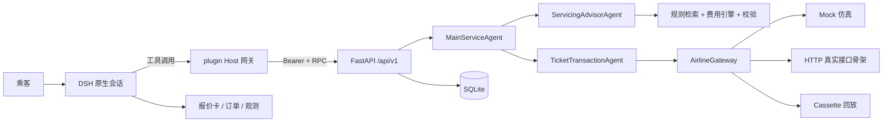

# AeroAgent

面向机票退改签场景的垂直 Agent：**DeepSeek Harness 负责前台交互，AeroAgent 后端负责业务大脑**。用户在 DSH 原生会话里查订单、看多方案、人工确认、办理退改，全程不离开宿主。

所有航班、订单、票价与航司回执均为虚构数据；项目不连接真实航司、GDS 或支付渠道。

## 为什么是 AeroAgent

| 亮点 | 业务价值 | 实现 |
|---|---|---|
| DSH 前台 + 业务大脑分层 | 交互可换、业务可控，不被宿主绑定 | 插件只做工具/网关/卡片；`app/` 保留三 Agent 与全部规则 |
| Agent 不能替用户花钱 | 确认与支付是用户动作，不是模型动作 | 工具表无 confirm/pay；按钮只在报价卡与预订页 |
| 确认后重核价 + 1% 保护 | 乘客确认价可执行，超幅强制重报 | `price_review` + `create_confirmed_operation` |
| 幂等 + 审计 + 对账 | 重试不重复出票，结果未知可核对 | 幂等键、唯一约束、`operations/{id}/reconcile` |
| 多方案改签 | 一次给出 2–5 个独立定价方案 | SmartMock 候选 + 费用引擎 + 画像排序 |
| 可解释执行 | 每条费用能追到规则、检索与航司回执 | 流程/检索/记忆/校验/回执五类观测 |
| 仿真航司可切换 | 演示真实，未来换真实接口只改适配器 | `mock / http / cassette` 三实现 |
| 全旅程闭环 | 查询 → 预订 → 支付 → 退改 → 监控 | Listing、Booking、Watches、Cases 四组 API |
| 可评测 | 规则与回归可量化 | 内置评测集、运行历史与失败明细 |

## 架构



`/app` 是系统 of record：订单、票规、价格、案件、交易、幂等、审计都在这里。DSH 模型只负责“听懂并调用工具”，后端决定“能不能办、多少钱、怎么办”。

## 快速启动（约 5 分钟）

先决条件：Python 3.13、[uv](https://docs.astral.sh/uv/)、已运行的 DSH Web 实例。首次 `uv sync` 需要拉依赖；首次真实检索会下载 BGE/flashrank 模型，想跳过可设 `AIR_RETRIEVAL=fallback`。

```bash
# 1. 后端
uv sync
uv run uvicorn app.api.main:app --host 127.0.0.1 --port 8000

# 2. 安装插件
#    方式 A（推荐）：DSH Web → Plugins → Add plugin → 选择 <仓库>/plugin
#    方式 B（有 dsh CLI 时）：
npx -y -p @deepseek-ai/dsh dsh plugin --profile web add /absolute/path/AeroAgent/plugin
```

> **只装到你实际打开的 Web 实例所属 profile。** 如果打开的是 DSH Desktop 里的 Web 视图，profile 是 `desktop`；如果是 `dsh --profile web` 启动的 Web，profile 是 `web`。AeroAgent 只提供 Web 客户端，不修改 Desktop 壳；插件默认 `allowedProfiles: [web]`，装到 desktop 会跳过注册。若误装到 desktop：`dsh plugin --profile desktop remove dsh-plugin-aeroagent`。

打开 DSH Web，左侧出现 **我的订单 / Listing / 低价监控 / 更多功能**。选一张订单，在对话里说“帮我改签到后天”，即可看到报价卡。

## 在 DSH 里能做什么

| 能力 | 入口 | 说明 |
|---|---|---|
| 我的订单 | 左侧导航 | 订单列表、选择客票、跳转退改对话；搜索/排序/分页由 API 与 Agent 工具提供 |
| 改签/退票 | 订单上下文 + 对话 | 多方案、费用明细、规则依据、推荐理由 |
| 人工确认 | 对话内报价卡 | 确认后重核价、幂等办理、进度与结果 |
| Listing | 左侧导航 | 航线/日期/舱位查询、待支付预订 |
| 支付 | 预订卡按钮 | 用户点击，Agent 无支付工具 |
| 低价监控 | 左侧导航 | 建监控、手动评估、站内提醒 |
| 执行观测 | 右侧栏 | 流程、检索、记忆、校验、回执；回执页与报价卡可发起对账 |
| 规则/评测/数据 | 左下学习导航 | 规则检索调试、跑评测、演示数据 |
| 仿真航司 | 更多功能 → 仿真航司 | 切换正常、台风、超时、拒绝等场景 |

## 配置

插件配置在 DSH 的插件行里：

```yaml
backendUrl: http://127.0.0.1:8000
identityMode: demo      # demo | token
demoUserId: u_zhang
enableAdminTools: false
```

后端运行配置在 `config.json`（从 `config.example.json` 复制）：

```json
{
  "mode": "mock",
  "airline": {
    "mode": "mock",
    "scenario": "normal"
  }
}
```

- `mode`：后端三 Agent 的决策模式，`mock`（默认、零 key）或 `deepseek`。
- `airline.mode`：`mock` / `http` / `cassette`。
- `airline.scenario`：`demo_data/airline_scenarios.json` 中的场景 id。

## 从 mock 到真实航司

业务代码只依赖 `AirlineGateway`：

```python
async def submit(command: dict) -> dict: ...
async def find_by_idempotency_key(key: str) -> dict | None: ...
```

| 实现 | 用途 |
|---|---|
| `MockAirlineGateway` | 场景化仿真：延迟、接受、拒绝、超时、票号/PNR |
| `HttpAirlineGateway` | 真实接口骨架：base_url、鉴权头、超时、状态码映射 |
| `CassetteAirlineGateway` | 录制/回放真实样本，离线回归 |

接入真实航司时只改 `airline.mode`、`base_url`、`auth_header` 和字段映射，不改案件、费用、幂等、审计。详见 [`docs/airline-integration.md`](docs/airline-integration.md)。

## 目录

```text
app/                 FastAPI、三 Agent、领域、适配器
tests/               后端单元/集成/端到端
migrations/          Alembic 迁移
demo_data/           虚构航班、订单、规则、航司场景
eval/                评测金标
plugin/              DSH 插件（Host + Client）
docs/                架构、API、插件、航司接入、演示脚本
scripts/             冒烟与文档检查
docker-compose.yml   仅后端容器
```

## 验证

```bash
UV_CACHE_DIR=./.uv-cache uv run pytest -q
uv run python scripts/check_docstrings.py
npm --prefix plugin test
node --check plugin/client.js
```

零 key 冒烟：

```bash
uv run uvicorn app.api.main:app --port 8123
uv run python scripts/smoke_lite.py
```

DSH 验收清单见 [`docs/demo-script.md`](docs/demo-script.md)。

## 边界

- 仅本地/单实例演示：进程内队列、SQLite、单写者。
- 演示令牌、mock 航司、关闭宿主鉴权不得用于生产。
- 真实航司字段未联调；`HttpAirlineGateway` 是适配器骨架，不是已完成对接。
- 多租户 OIDC、Postgres/Redis 多实例不在本期范围。

## 文档

- [架构](docs/architecture.md)
- [API v1](docs/api-v1.md)
- [DSH 插件接入](docs/dsh-plugin.md)
- [航司接入](docs/airline-integration.md)
- [演示脚本](docs/demo-script.md)
- [运行手册](docs/runbook.md)

## License

[MIT](LICENSE)
