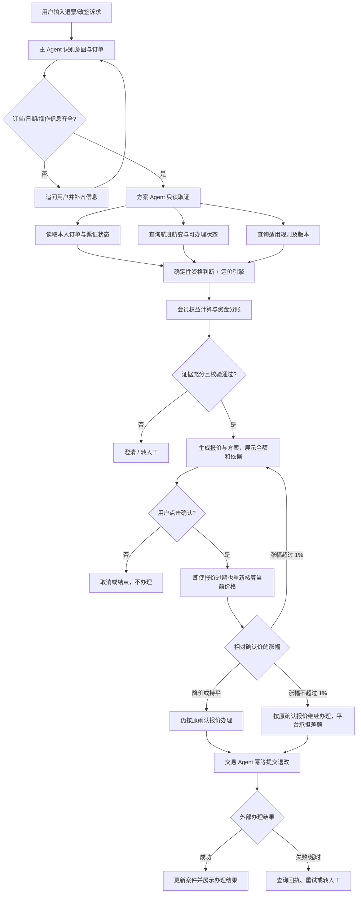

# 机票退改签 Agent：业务亮点与最终技术方案

- 状态：已批准，本轮代码重构已落阶段性骨架；剩余项见文末“重构状态”
- 定位：外部辅导学习项目；用真实业务问题讲清 DDD、多 Agent、资金决策和生产质量。
- 边界：航司、订单、规则、接口均为演示数据；不声称接入真实 GDS 或出票/退款系统。

## 先讲项目亮点

| 亮点 | 业务设计 | 学员可以演示什么 |
|---|---|---|
| **四梯度会员权益** | 普通/银卡/金卡/黑钻采用不同服务优先级和平台权益额度。会员权益不能改写航司退改规则，补贴单独记为平台承担。 | 同一票规下，不同等级得到不同服务，但航司费用来源不变。 |
| **三 Agent 安全分工** | 主 Agent 编排、方案 Agent 只读核验、交易 Agent 确认后执行；确定性业务服务最终裁定资格和金额。 | 展示查询、决策、交易权限彼此隔离。 |
| **航变与自愿退改分流** | 先确认航班事件及客票条件，再选择自愿/非自愿办理路径。证据矛盾或不足时转人工。 | 同一订单分别演示旅客自愿退票和航班取消后的非自愿退票。 |
| **资金分账与权益核算** | 分列航司费用、票价差额、退款、平台补贴和旅客实付/实退；按规则版本、报价和操作记录。 | 航司费用 500 元、平台补贴 100 元，账单呈现旅客支付 400 元、平台承担 100 元。 |
| **确认后 1% 价格保护** | 用户确认后仍复核订单、票价、库存和权益；报价过期本身不触发重报价，按变价幅度处理。交易幂等防重复办理。 | 演示 1% 内继续办理、超过 1% 才重新确认、重复确认只办理一次。 |
| **DDD 业务分层** | Ticket、Policy、Servicing、Pricing/Finance、Loyalty、Fulfillment 业务上下文；外部系统经适配器隔离。 | 切换模拟航司/订单适配器时，核心业务规则不跟着改。 |
| **评测、Trace、安全、部署** | 用逐步指标、全链路输入输出、故障演练和安全规则证明系统质量。 | 定位失败在理解、工具、检索、模型或外部接口的哪一步。 |

民航局旅客提示区分自愿/非自愿退改，并指出不同客票产品的退改条件有差异；因此系统必须核对具体客票和规则，不能只按用户一句话判断。[来源：中国民航局旅客出行提示](https://www.caac.gov.cn/INDEX/HLFW/HKLXCS/202303/t20230316_217590.html)

## Agent 拆分与编排

**交互时序图：**[打开 Archify 全链路图](../../../.archify/sequence-ticket-change-mainline-20261111-213248/ticket-change-mainline.html)。参与者从左到右排列，调用顺序从上到下；缺信息、用户取消、条件变化和办理结果未知都标在对应步骤。

### 数量、名称与权限

目标方案是 **3 个 Agent**。LangGraph 是流程编排器，不另算一个 Agent。

| Agent | 职责 | 权限边界 |
|---|---|---|
| **主 Agent（Main Service Agent）** | 识别意图、补问关键信息、选择订单、拆分诉求并调度其他 Agent；汇总结果并解释下一步。 | 不直接计算费用、不执行退改；只能访问当前登录用户有权查看的订单。 |
| **方案 Agent（Servicing Advisor Agent）** | 只读查询本人订单、规则、航变和外部可办理状态；收集证据并请求业务服务核定可退/可改条件、金额和备选方案。 | 查询权限受后端用户身份约束；不能修改订单或提交交易。可办理性与金额由确定性服务判定。 |
| **交易 Agent（Ticket Transaction Agent）** | 在乘客点击确认后，提交已确认的改签/退票方案，查询办理状态并处理回执。 | 高危写权限；只接受绑定 `quote_id + action + amount + confirm_id` 的确认命令，幂等执行。不能自行改方案或金额。 |

主 Agent 是负责对话和委派的 Agent；LangGraph Case Orchestrator 管节点顺序、分支、暂停和恢复。会员权益、规则适用、费用核算、权限校验仍是确定性业务服务，不再额外拆成 Agent。

### 从用户输入到完成办理



**核心顺序：**查询可并行；资格和金额必须在证据齐全后由业务服务计算；用户确认绑定具体报价；交易 Agent 只能在确认后执行。报价过期不单独导致重报价：当前应付价不高于确认价，仍按确认价办理；涨幅 ≤1% 时仍按确认价办理、差额由平台承担；涨幅 >1% 才生成新报价并要求再次确认。库存/资格失效、规则变化或航班状态变化导致方案不可办时，仍须重新出方案。**注意：**按此口径，降价差额不自动让利给用户；若目标是价格保护，建议把降价改为按更低价办理。

### 确认后价格复核规则

比较同一乘机人、同一操作、同一权益版本下的**旅客最终应付金额**，不比较裸票价或单项手续费。设确认金额为 `Q`，复核金额为 `R`：

| 复核结果 | 系统动作 | 用户确认 |
|---|---|---|
| `R ≤ Q`（降价或持平） | 按已确认金额 `Q` 办理 | 不重复确认 |
| `Q < R ≤ Q × 1.01` | 仍按 `Q` 办理，差额记为平台价格保护成本 | 不重复确认 |
| `R > Q × 1.01` | 生成新报价并展示差额、明细和有效期 | 必须再次确认 |

报价有效期约束未确认报价；用户点击确认后，复核进入价格保护流程。保存 `Q`、`R`、差额承担方、计算依据及规则/权益版本，供账务核对。退款场景按“旅客应收金额”另行定义，退款减少不得未经用户确认直接执行。

**版本节奏：**Phase 1 先用现有单 Agent 完成可信业务闭环；Phase 2 重构为上述三 Agent 分工。这样先验证业务边界，再引入多 Agent，不会先搭一套空壳协作框架。

## 会员与资金决策

等级权益属于**平台额外提供的服务**，不覆盖或削弱航司/票价合同下的权益。下表是教学用虚构策略，实际额度应由配置和版本控制。

| 等级 | 服务策略示例 | 权益示例 | 限制 |
|---|---|---|---|
| 普通 | 标准服务队列 | 通用服务保障 | 不因等级减少基础权利 |
| 银卡 | 优先队列 | 小额服务费券/积分 | 次数、有效期和适用操作受限 |
| 金卡 | 更高优先级、航变主动通知 | 较高服务补贴额度 | 不能保证有目标舱位 |
| 黑钻 | 专属优先队列、复杂案件专员 | 更高但封顶的服务恢复额度 | 超额或例外需人工审批 |

决策顺序：**核实会员 → 按航司规则计算基础金额 → 检查权益资格/额度 → 单列平台承担 → 生成旅客实付/实退 → 确认时再次校验。** 示例：航司改签费 300 + 票价差额 200，金卡平台权益抵扣 100，乘客应付 400；账上仍记录航司费用 300、差价 200、平台承担 100，不能把航司费用改成 200。

## DDD 如何落到机票业务

借鉴 [easy-DDD](https://github.com/alizhangsan602-bit/easy-DDD) 的领域隔离、依赖倒置、应用场景编排和外部适配器；按当前 Python 项目改造职责，不机械照搬 Java 包名。

| 业务上下文 | 负责什么 | 对应架构位置 |
|---|---|---|
| Ticket / Order | 订单、客票、乘机人、行程和票联状态 | Domain + Repository Port |
| Policy | 规则条件、来源、生效版本和适用判断 | Domain + Rule Repository |
| Servicing | 案件状态、澄清、确认、人工审核 | Application Use Case + Case Aggregate |
| Pricing / Finance | 费用计算、平台补贴、资金流水和对账 | Domain Service + Quote/Ledger |
| Loyalty | 等级、权益额度、有效期、使用记录 | Loyalty Aggregate + Benefit Service |
| Fulfillment | 模拟或真实退改签指令、回执、幂等和结果核对 | Output Adapter |
| Agent / API | 语言理解、工作流编排、HTTP/SSE 界面 | Application Orchestrator + Input Adapter |

LangGraph checkpoint 只恢复对话流程；Case、Quote、Operation 和 Ledger 才是业务记录。不能把 LangGraph State 当成订单账本。

## 从 Demo 到生产级：四项必备能力

### 1. Eval：分层评测，不只看最终回答

- **固定金标准**：输入、订单/规则前置事实、预期工具/步骤、金额、引用和评分 Rubric；金额真值由独立样例审核，不能只用被测运价引擎生成。
- **分步骤指标**：意图/订单识别准确率、每步工具选择准确率、规则命中率、金额准确率、引用有效率、确认安全率、最终成功率、延迟和模型成本。
- **多轮评测**：逐轮和逐步检查；前一步错导致后续错误要定位到第一个偏差步骤，不能只用整段最终成功率。
- **动态评测**：LLM-as-Judge 按固定 Rubric 辅助评分；高风险金额、规则和安全项由人工金标准复核。
- **Bad Case 飞轮**：线上/演示失败 → 脱敏 → 分类标注 → 加入回归集 → 修复后比较，避免重复踩坑。

### 2. Trace：全链路可观测

每轮串起 `case_id / trace_id / session_id / quote_id / operation_id`；记录 Agent、Prompt 版本、工具入参出参、检索候选和过滤原因、规则版本、模型与 Token、耗时、重试和最终状态。可选 LangSmith / Langfuse；本地先用结构化事件。目标是能回答：**错在理解、工具参数、规则检索、业务计算、模型表达，还是外部接口？**

### 3. Deploy：可复现部署

Docker Compose 一键启动 API、Web、PostgreSQL、Redis、Qdrant 及模拟航司服务；锁定依赖和模型版本；`.env.example` 管配置，密钥不进仓库；提供健康检查、日志、数据重置和一键演示脚本；LLM 调用设置超时、预算与成本上限。当前业务继续用模拟航司适配器，不暗示真实部署能力。

### 4. Security：权限、确认和故障兜底

- 退票/改签等危险操作必须绑定具体方案、金额和乘客确认；系统工具权限最小化。
- 用户输入、规则文档和检索内容都是不可信数据；防 Prompt Injection、越权查他人订单、隐私泄露和工具滥用。
- Agent 只读取证/说明；办理工具只允许 Orchestrator 在确认和复核通过后调用。
- 设置超时、重试上限、熔断、LoopDetector、输出长度/Token 限额和人工降级。
- 操作幂等；超时但无法确认结果时标记“结果待核实”，先查询后续状态，不盲目二次办理。

## 当前 FastAPI 路由清单

根据 `app.py` 路由装饰器逐项盘点，共 **25 个 HTTP 路由**；静态前端挂载 `/` 不计入 API。

| 分组 | 方法 | 路径 | 用途 |
|---|---|---|---|
| 对话 | POST | `/api/chat` | 发起对话并流式返回 Agent 事件 |
| 对话 | POST | `/api/resume` | 提交补充/确认并恢复中断流程 |
| 对话 | GET | `/api/sessions/{session_id}` | 查询中断点及会话记忆摘要 |
| 演示数据 | GET | `/api/users` | 列出演示用户档案 |
| 演示数据 | GET | `/api/orders` | 查询订单，可按 `user_id` 过滤 |
| 演示数据 | POST | `/api/flights/{flight_no}/{date}/status` | 修改演示航班状态/延误分钟数 |
| 演示数据 | POST | `/api/data/reset` | 重置演示数据 |
| 用户记忆 | DELETE | `/api/profiles/{user_id}/memory` | 清除用户长期记忆 |
| 规则管理 | GET | `/api/rules` | 按航司、舱位、票价产品、场景筛选规则 |
| 规则管理 | POST | `/api/rules` | 新建规则（201） |
| 规则管理 | PUT | `/api/rules/{rule_id}` | 更新规则 |
| 规则管理 | DELETE | `/api/rules/{rule_id}` | 删除规则 |
| 规则检索 | POST | `/api/rules/search-debug` | 调试检索结果、过滤条件和耗时 |
| 评测用例 | GET | `/api/eval/cases` | 读取金标准用例集 |
| 评测用例 | PUT | `/api/eval/cases` | 校验并保存用例集，保留备份 |
| 评测用例 | POST | `/api/eval/cases/validate` | 校验用例格式与引擎约束 |
| 评测运行 | POST | `/api/eval/runs` | 启动评测（201） |
| 评测运行 | GET | `/api/eval/runs/{run_id}/stream` | 通过 SSE 获取评测进度和结果事件 |
| 评测运行 | GET | `/api/eval/runs` | 列出历史运行及当前活动运行 |
| 评测运行 | GET | `/api/eval/runs/{run_id}` | 查询单次评测报告 |
| 配置 | GET | `/api/config` | 读取公开配置（密钥脱敏） |
| 配置 | PUT | `/api/config` | 更新并校验运行配置 |
| 配置 | POST | `/api/config/reset` | 重置配置，保留已配置的 LLM Key |
| 配置 | POST | `/api/config/test-llm` | 测试 LLM 连通性 |
| 运行状态 | GET | `/api/status` | 查看模式、检索状态、模型和评测状态 |

**边界提示：**这是当前演示服务的完整路由清单，不代表已有生产身份认证/授权；订单、规则和配置等接口上线前需加认证、角色权限和审计。

### API 收敛目标：25 条降到 15 条

25 条不是单纯“太多”，而是把演示数据维护、规则调试、评测、配置等内部能力全部暴露成独立 HTTP 接口。目标将用户业务入口、运营管理入口和开发脚本分开，稳定对外 API 控制在 **15 条**：

| # | 方法 | 目标路径 | 用途/合并方式 |
|---:|---|---|---|
| 1 | POST | `/api/v1/cases` | 用用户诉求创建退改案件，返回 `case_id` |
| 2 | GET | `/api/v1/cases/{case_id}` | 查询案件、当前方案和办理状态；替代会话状态查询 |
| 3 | POST | `/api/v1/cases/{case_id}/messages` | 追加消息、补充信息或恢复暂停的流程；合并 chat/resume |
| 4 | GET | `/api/v1/cases/{case_id}/events` | SSE 推送 Agent、报价和办理事件 |
| 5 | POST | `/api/v1/quotes/{quote_id}/confirm` | 明确确认绑定报价；超 1% 返回 `REQUOTE_REQUIRED`，不调用交易 |
| 6 | GET | `/api/v1/orders` | 只返回登录用户自己的订单，不接受任意 `user_id` |
| 7 | GET | `/api/v1/admin/rules` | 规则列表/筛选，调试字段按管理员权限返回 |
| 8 | PUT | `/api/v1/admin/rules/{rule_id}` | 创建/更新/停用规则；停用替代物理删除，保留审计 |
| 9 | GET | `/api/v1/admin/evaluations` | `view=cases` 或 `view=runs` 查询评测集或运行列表 |
| 10 | PUT | `/api/v1/admin/evaluations/cases` | 更新评测集并保留版本/变更记录 |
| 11 | POST | `/api/v1/admin/evaluations/runs` | 启动一次评测，worker 异步执行 |
| 12 | GET | `/api/v1/admin/evaluations/runs/{run_id}` | 轮询评测状态或读取最终报告 |
| 13 | GET | `/api/v1/admin/config` | 读取脱敏配置和运行状态 |
| 14 | PUT | `/api/v1/admin/config` | 更新配置；请求可选 `probe_llm=true` 做连通性验证 |
| 15 | GET | `/api/v1/health` | 健康检查及依赖就绪状态 |

**从 API 移出的能力：**重置种子数据、模拟航变、清除演示记忆改为本地 `scripts/demo.py` 命令；LLM 测试合并配置更新参数；规则搜索调试并入管理员规则查询；评测校验在保存和启动时由服务端执行。用户 ID 从已验证身份获取，不由请求体指定。

## 最终技术方案

采用**模块化单体 + DDD 六边形架构**：先把领域边界、端口和适配器做清楚，同一应用内运行；API 与异步 worker 可独立部署。借鉴 Globex 的技术栈与工程措施，不复制商品域，也不为了“微服务化”引入跨服务事务。

| 机票退改签项目（最终方案） | GlobexAgent 项目（当前方案） | 差异点对比 |
|---|---|---|
| **领域架构：DDD 六边形架构**；Ticket、Policy、Servicing、Pricing/Finance、Loyalty、Fulfillment 六个业务上下文，通过端口连接外部设施 | **DDD 洋葱架构**；domain/application/infrastructure/presentation 分层，覆盖商品搜索、订单和买家偏好 | 都让业务规则独立于框架；机票以退改案件、报价、资金流水和航司办理为核心，按六边形依赖方向组织，不照搬 Globex 商品领域。 |
| **Agent：LangGraph + 主/方案/交易三 Agent**；checkpoint、interrupt/resume；交易 Agent 与写工具隔离 | **AgentScope 2.x + Main/Search/Trade**；Task 计划、动态 `task_dispatch`、类型化事件流 | Globex 强在动态并行搜索；机票强在确认、复核、暂停、恢复和幂等交易。保留 LangGraph，流程图负责调度，业务服务负责资格与金额裁定。 |
| **后端：Python 3.13 + FastAPI + Pydantic**；稳定 API 目标 15 条，SSE 用于案件事件 | **Python 3.11 + FastAPI + WebSocket**；REST 意图接口、WebSocket 会话事件 | 延续机票现有 FastAPI/LangGraph；SSE 与浏览器原生支持匹配且简单，后台事件通过 Redis 转发，不要求前端改 WebSocket。 |
| **前端：React 18 + Vite + TypeScript**；按对话办理台、案件详情、运营评测区拆功能 | **React 18 + Vite + TypeScript**；对话流、商品卡、事件时间线 | 直接对齐 Globex 的成熟栈，避免维护原生 JS 页面；机票界面以金额明细、规则依据、状态轨迹和二次确认突出业务重点。 |
| **关系数据：PostgreSQL + SQLAlchemy async**；Case、Quote、Operation、Ledger、规则版本和审计为事实来源 | **SQLite + SQLAlchemy async**；会话/事件/订单落地，商品目录为内存种子数据 | 学习项目按生产一致性选择 PostgreSQL；SQLite 保留给轻量单测。所有金额/确认/幂等结果以数据库为准。 |
| **缓存/队列：Redis**；评测/长任务 Redis Streams；worker 到 API 的跨进程事件流；限流和短期缓存 | **Redis 可选**；Streams 队列、Pub/Sub 背板、语义/Embedding 缓存和幂等键 | 复用 Globex 的削峰与跨进程事件设计。机票不缓存报价与资金判断；幂等最终由数据库唯一约束兜底，Redis 不做账本。 |
| **规则检索：Qdrant + 本地 BGE-small-zh + BM25/RRF + FlashRank**；结构化条件先过滤，检索只辅助找规则依据 | **Qdrant + OpenAI 兼容 Embedding + HTTP Reranker + RAG**；多级关键词/向量降级 | 机票优先保证规则适用条件正确，再重排文本；模型/检索不得自行决定可退金额。保留当前检索方案，借鉴 Globex 降级和过滤原因。 |
| **生产工程：Docker Compose + API/worker/PostgreSQL/Redis/Qdrant/Web；OpenTelemetry Trace；逐步 Eval；RBAC/审计** | **Docker Compose + app/worker/Qdrant/Redis/React；Tracing、评测集与回归脚本** | 基础栈相近；机票额外把交易确认、资金账本、隐私脱敏和价格保护纳入生产门禁。先 Compose，可观测和扩缩容有明确需求后再上 Kubernetes。 |

### DDD 六边形业务边界与三个 Agent

- **Ticket & Policy 域**：订单/客票/航段、航司票规及规则版本；适用条件由确定性规则服务判定。
- **Servicing 域**：退改案件状态、补充材料、用户确认、人工复核和办理闭环。
- **Pricing/Finance 域**：金额计算、报价快照、1% 价格保护差额、平台权益分摊、资金流水与对账。
- **Loyalty 域**：普通/银卡/金卡/黑钻权益、额度、有效期、核销记录。
- **Fulfillment 域**：模拟或真实航司适配器、退改指令、幂等和回执核验。
- **六边形端口**：输入端口为 REST/SSE 与管理命令；输出端口为 PostgreSQL、Redis、Qdrant、LLM、航司适配器、Trace/指标。

链路由 LangGraph 驱动：**主 Agent**识别意图并调度；**方案 Agent**只读查证，调用领域服务生成可行方案；用户点击确认后 graph 暂停等待明确确认；**交易 Agent**接收带 `quote_id + amount + confirmation_id` 的命令，经领域校验、数据库幂等约束后调用航司适配器。Agent 不持有数据库/资金直接写权限。

### 生产中间件与质量门禁

| 能力 | 方案 |
|---|---|
| Redis 队列 | Redis Streams 承载评测和长耗时任务；consumer group、ack、有限重试、死信队列；worker 重启可恢复。 |
| Redis 事件 | worker 发布带 `case_id/trace_id` 的事件；API 将事件转 SSE；关键案件事件同时持久化，避免 Pub/Sub 丢失后状态不可恢复。 |
| 交易一致性 | PostgreSQL 事务内写 Operation、Ledger 和 Outbox；worker 发送办理命令，消费端按幂等键处理并回写回执，避免数据库提交与消息发送出现半成功。 |
| Redis 缓存/保护 | 缓存带规则版本号的只读规则结果；并发限流/短 TTL 防重放。报价、规则最终判断、资金账本和幂等真值以 PostgreSQL 为准。 |
| Eval | 固定金标准按步骤评分：意图/订单、工具选择与参数、规则适用、金额、报价确认、办理结果；财务真值人工审核；每次改 Prompt/规则/模型跑回归。 |
| Trace | OpenTelemetry 串起 API → graph/Agent → 工具 → 检索/数据库/Redis/LLM → 航司适配器；关联 `case_id/quote_id/operation_id`，密钥和 PII 脱敏。 |
| Deploy | Docker Compose 提供本地可复现的一键环境；迁移脚本、健康/就绪探针、结构化日志、指标、超时预算和依赖锁定。密钥通过环境/密钥管理器注入。 |
| Security | Bearer 身份映射服务端 `user_id`；角色控制管理 API；交易确认绑定报价版本、金额和单次确认 ID；数据库唯一约束防重复；审计日志不可被业务请求删除。 |

### 前端技术与视觉标准

前端对齐 Globex 的 **React 18 + Vite + TypeScript**。实现界面时先审视现有页面，再按 taste-skill（[design-taste-frontend](https://github.com/Leonxlnx/taste-skill)）完成行业定位、设计 tokens、页面布局和真实浏览器检查；将其规则适配办理工作台，不照抄营销落地页。

- 页面仅保留核心路径：**办理工作台**（诉求、订单选择、报价/确认）→ **案件详情**（费用来源、规则依据、状态时间线）→ **运营台**（规则、评测与运行状态）。
- 使用一套颜色/字号/间距/控件 token；对齐版心和边距，减少卡片嵌套、装饰图和无业务价值的动效；金额、差额承担方、确认按钮和风险状态有明确视觉层级。
- 展示真实产品界面片段、清晰空态/错误态/加载态；保证键盘可用、对比度、窄屏适配与 `prefers-reduced-motion`。
- 前端交付前用真实浏览器检查 1440/1024/768/390 等视口，检查溢出、断行、操作可见性和页面截图；taste-skill checker 可用时纳入交付门禁。

### 目标代码骨架

```text
air-ticket-agent/
├── backend/
│   ├── app/
│   │   ├── domain/                  # 纯业务，不依赖 FastAPI/Agent/Redis
│   │   │   ├── ticket/              # Ticket、Order、Passenger、航段状态
│   │   │   ├── policy/              # 规则版本、适用性、航变政策
│   │   │   ├── servicing/           # Case 聚合、退改状态机、确认状态
│   │   │   ├── pricing/             # Quote、金额计算、1% 价格保护
│   │   │   ├── finance/             # Ledger、平台补贴、对账
│   │   │   ├── loyalty/             # 会员等级、权益额度和核销
│   │   │   └── fulfillment/         # 办理命令、幂等、回执
│   │   ├── application/             # 用例、DTO、事务边界和领域端口
│   │   │   ├── cases/               # CreateCase、BuildPlan、ConfirmQuote
│   │   │   ├── ports/               # Repository、LLM、队列、航司接口
│   │   │   ├── orchestration/       # LangGraph 状态图、节点和中断恢复
│   │   │   └── agents/              # MainAgent、SolutionAgent、TransactionAgent
│   │   ├── adapters/                # 六边形外部适配器
│   │   │   ├── inbound/http/        # FastAPI routers、auth、request/response
│   │   │   ├── outbound/postgres/   # SQLAlchemy models/repositories/UoW
│   │   │   ├── outbound/outbox/      # 交易/评测事件事务外发
│   │   │   ├── outbound/redis/      # Streams、事件背板、限流
│   │   │   ├── outbound/qdrant/     # 向量检索、embedding、reranker
│   │   │   ├── outbound/llm/        # 模型客户端、超时、重试和预算
│   │   │   ├── outbound/airline/    # 航司模拟器/真实供应商适配器
│   │   │   └── outbound/telemetry/  # OpenTelemetry、日志、指标
│   │   ├── api/                     # 15 条版本化路由的组装层
│   │   ├── config/                  # 配置读取和校验
│   │   └── composition.py           # API 与 worker 共享依赖装配
│   ├── worker.py                    # Redis consumer：评测/长任务/事件
│   ├── migrations/                  # PostgreSQL schema migration
│   └── tests/                       # domain、adapter contract、API、eval
├── frontend/
│   ├── src/
│   │   ├── app/                     # 路由、布局、全局状态
│   │   ├── features/                # servicing、cases、orders、evaluation、admin
│   │   ├── components/              # 业务组件和可访问性基础控件
│   │   ├── design-system/           # tokens、字体、色彩、间距
│   │   └── api/                     # 类型化 API 客户端、SSE 订阅
│   └── public/
├── eval/                            # 金标准、rubric、回归基线
├── infra/                           # Dockerfile、compose、监控配置
├── scripts/                         # seed、demo reset、评测、开发工具
├── docs/                             # 业务设计、架构图、API、运行手册
├── docker-compose.yml               # web + api + worker + postgres + redis + qdrant
└── pyproject.toml / package.json
```

**重构顺序：**先立领域模型和端口、PostgreSQL 数据迁移及 15 条 API 契约；再抽 LangGraph 三 Agent 和交易确认边界；随后接 React 办理台、Redis worker/事件；最后补齐 Eval/Trace/Deploy/Security 门禁。实施按 `docs/superpowers/plans/2026-11-11-air-ticket-ddd-hexagonal-refactor.md` 分阶段推进。

## 实施顺序与当前边界

1. **Phase 1：业务闭环**：DDD 核心对象、规则适用、基础费用与资金分账、报价快照、会员策略、确认复核、幂等操作；先用单 Agent。
2. **Phase 2：三 Agent 亮点**：主 Agent 编排、方案 Agent 只读核验、交易 Agent 确认后执行；评测逐 Agent 的权限与交接。
3. **Phase 3：生产工程**：固定与动态评测、Bad Case 回流、Docker、成本控制、安全与故障演练。

### 本轮重构状态（2026-11-11）

已落地：DDD 六边形目录与领域对象、PostgreSQL 案件/报价/操作/账本/审计模型、事务 Outbox + Redis Streams、确认后 1% 复核和幂等交易、15 条版本化 API、React/Vite/TypeScript 办理台、Compose、基础 API Trace、Bearer/RBAC 与 API/运行文档。现有 LangGraph 仍通过兼容层运行，checkpoint 仍使用 SQLite；mock 航司不代表真实 GDS 集成。

尚未完成：会员权益的额度核销和实际报价减免、LangGraph 编排拆分为独立多 Agent 子图、财务独立金标准、全链路 Agent/检索/数据库 Trace 与安全防护门禁、生产身份源和真实航司对账。它们保留为后续阶段，不在当前代码状态中宣称已实现。
